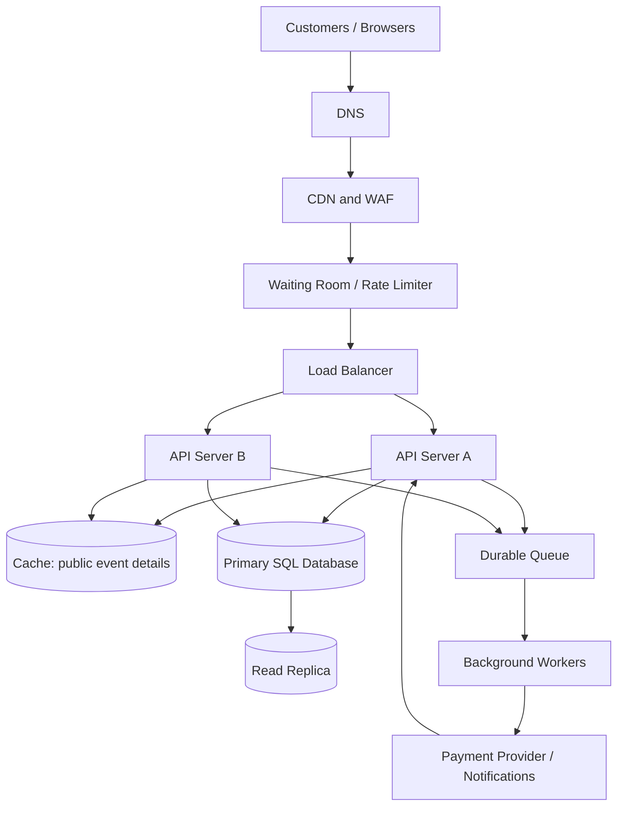

# TicketHub: System Design

## 1. Requirements

### Functional requirements
1. Visitors can browse, search, and filter events by name, date, venue, category, and location.
2. Visitors can view event details, prices, seating sections, and current seat availability.
3. Registered users can sign in and select seats for an event.
4. Users can place a temporary hold on available seats. A hold expires after five minutes if checkout is not completed.
5. Users can pay for held seats and receive a confirmed order and ticket.
6. Users can view their orders and tickets, including event details, seat numbers, and order status.
7. The service handles payment success, failure, cancellation, and refunds and sends order confirmations.
8. Organizers or administrators can create events, configure seats and prices, and manage event availability.

### Non-functional requirements
- **Speed:** event and seat-map reads should normally return within 300 ms at the 95th percentile, excluding third-party payment time.
- **Correctness:** a seat can have at most one active hold or confirmed sale. Payment success must be linked to one valid order. Retries must not create duplicate orders or charges.
- **Fairness:** use a waiting room or queue for high-demand sales, apply a consistent admission policy, rate-limit automated abuse, and give admitted customers a clear checkout time limit. Repeated refreshes must not let users jump the queue.
- **Availability:** target 99.9% monthly availability for browsing and purchasing, with graceful degradation during overload.
- **Security:** use HTTPS, secure authentication, authorization, input validation, payment-provider tokenization, and audit logs. Never store raw card details.
- **Scalability:** scale stateless application servers horizontally and isolate sale traffic from unrelated events.
- **Durability:** persist orders and seat allocations transactionally, back up data, and test recovery.
- **Accessibility:** support keyboard-accessible seat selection and never use color alone to communicate availability.

## 2. Traffic and capacity estimates

These are planning estimates, not measured traffic. Averages hide bursts, so load testing is required.

### Normal day
- Visitors: **50,000 per day**.
- Page views: 50,000 × 10 = **500,000 page views/day**.
- Average page views per second: 500,000 ÷ 86,400 ≈ **5.8 page views/second**, assuming one main request per page.
- If each page view triggers five additional API calls, application traffic is about 3,000,000 requests/day, or **34.7 requests/second on average**.
- Tickets sold: **5,000/day**, averaging 5,000 ÷ 86,400 ≈ **0.058 ticket sales/second**.
- Registered users: **2 million**.

Assume ordinary peaks can reach five times the average: plan initially for about **175 application requests/second** and validate with load tests.

### Popular concert sale
- Interested buyers: **200,000 within 10 minutes**.
- Average buyer attempts: 200,000 ÷ 600 seconds ≈ **333 buyers/second**.
- Seats available: **20,000**.
- Demand-to-supply ratio: 200,000 ÷ 20,000 = **10 buyers per seat**.
- At most 20,000 buyers can get one seat each; at least 180,000 interested people will not get one of these seats if each wants one.
- If each buyer makes 10 API requests in the window, total traffic is 2,000,000 ÷ 600 ≈ **3,333 requests/second on average**. Bursts may be several times higher.

| Metric | Normal day | Popular-sale window |
|---|---:|---:|
| Visitors/buyers | 50,000/day | 200,000/10 minutes |
| Application requests | ~34.7/s average under stated assumption | ~3,333/s average under 10 requests/buyer |
| Ticket demand | 5,000/day | 20,000 seats for 200,000 buyers |
| Main concern | Cost-effective everyday operation | Burst protection, fairness, and seat correctness |

The sale window could produce roughly 96 times the normal-day average request rate under these assumptions. A waiting room, caching for public event data, and strict transactional seat allocation prevent all visitors from overwhelming the purchase database.

## 3. API design

Use a versioned HTTPS JSON API under `/api/v1`. Authenticated endpoints require a valid session or bearer token. The server derives user identity from authentication, not from a client-supplied user ID.

| Method | Endpoint | Purpose | Success |
|---|---|---|---|
| GET | `/api/v1/events` | Browse/search events with pagination | `200 OK` |
| GET | `/api/v1/events/{eventId}` | View event details, venue, date, pricing | `200 OK` |
| GET | `/api/v1/events/{eventId}/seats` | View seat map and availability | `200 OK` |
| POST | `/api/v1/holds` | Temporarily hold one or more seats | `201 Created` |
| DELETE | `/api/v1/holds/{holdId}` | Release a user's active hold | `204 No Content` |
| POST | `/api/v1/orders` | Create an order from an active hold | `201 Created` |
| POST | `/api/v1/orders/{orderId}/payment` | Start/confirm payment through provider | `202 Accepted` or `200 OK` |
| GET | `/api/v1/me/orders` | List the signed-in user's orders | `200 OK` |
| GET | `/api/v1/me/tickets` | View confirmed tickets | `200 OK` |

### Example: hold seats

`POST /api/v1/holds`

```json
{
  "eventId": "evt_204",
  "seatIds": ["seat_A12", "seat_A13"],
  "idempotencyKey": "checkout-8d2f1a"
}
```

Response (`201 Created`):

```json
{
  "holdId": "hold_991",
  "status": "active",
  "expiresAt": "2026-10-27T19:25:00Z",
  "seats": [
    {"seatId": "seat_A12", "label": "A12"},
    {"seatId": "seat_A13", "label": "A13"}
  ]
}
```

If another customer holds or bought a requested seat, return `409 Conflict` and do not create a partial hold unless partial success is explicitly documented.

### Example: create an order

`POST /api/v1/orders`

```json
{
  "holdId": "hold_991",
  "idempotencyKey": "order-8d2f1a"
}
```

The server verifies that the hold belongs to the authenticated user, is active, and covers the requested seats. A ticket is issued only after verified payment success and a committed order/seat state transition.

### Error behavior
- `400 Bad Request`: malformed input.
- `401 Unauthorized`: missing or invalid login.
- `403 Forbidden`: user lacks permission.
- `404 Not Found`: resource does not exist or is not visible to the user.
- `409 Conflict`: seat unavailable, hold expired, or state conflict.
- `422 Unprocessable Content`: valid JSON with invalid field values, if adopted consistently.
- `429 Too Many Requests`: rate limit or waiting-room policy exceeded.
- `500 Internal Server Error` / `503 Service Unavailable`: unexpected failure or temporary overload.

Use idempotency keys for hold/order/payment initiation so retries do not create duplicate orders or charges. Verify payment webhook signatures and process callbacks idempotently.

## 4. Data model

A relational database such as PostgreSQL suits this system because seat allocation and order confirmation require transactions, foreign keys, and uniqueness constraints.

### Tables and relationships
1. **users** — one user can create many orders (`users 1 → many orders`).
2. **events** — one event has many seats and many orders.
3. **seats** — each seat belongs to one event and has a label such as `A12`.
4. **orders** — each order belongs to one user and one event.
5. **order_seats** — junction/allocation table connecting orders to seats, recording allocation status and hold expiry. This extra table is needed to model seat allocation reliably.

### PostgreSQL schema

```sql
CREATE TABLE users (
    id BIGINT GENERATED ALWAYS AS IDENTITY PRIMARY KEY,
    email VARCHAR(254) NOT NULL UNIQUE,
    password_hash TEXT NOT NULL,
    created_at TIMESTAMPTZ NOT NULL DEFAULT NOW()
);

CREATE TABLE events (
    id BIGINT GENERATED ALWAYS AS IDENTITY PRIMARY KEY,
    title VARCHAR(200) NOT NULL,
    venue VARCHAR(200) NOT NULL,
    starts_at TIMESTAMPTZ NOT NULL,
    sales_open_at TIMESTAMPTZ,
    status VARCHAR(20) NOT NULL DEFAULT 'draft'
        CHECK (status IN ('draft', 'scheduled', 'on_sale', 'sold_out', 'cancelled')),
    created_at TIMESTAMPTZ NOT NULL DEFAULT NOW()
);

CREATE TABLE seats (
    id BIGINT GENERATED ALWAYS AS IDENTITY PRIMARY KEY,
    event_id BIGINT NOT NULL REFERENCES events(id) ON DELETE CASCADE,
    seat_label VARCHAR(30) NOT NULL,
    section VARCHAR(60),
    price_cents INTEGER NOT NULL CHECK (price_cents >= 0),
    created_at TIMESTAMPTZ NOT NULL DEFAULT NOW(),
    UNIQUE (event_id, seat_label)
);

CREATE TABLE orders (
    id BIGINT GENERATED ALWAYS AS IDENTITY PRIMARY KEY,
    user_id BIGINT NOT NULL REFERENCES users(id),
    event_id BIGINT NOT NULL REFERENCES events(id),
    status VARCHAR(20) NOT NULL DEFAULT 'pending'
        CHECK (status IN ('pending', 'paid', 'cancelled', 'refunded', 'payment_failed')),
    total_cents INTEGER NOT NULL CHECK (total_cents >= 0),
    idempotency_key VARCHAR(100) NOT NULL,
    created_at TIMESTAMPTZ NOT NULL DEFAULT NOW(),
    updated_at TIMESTAMPTZ NOT NULL DEFAULT NOW(),
    UNIQUE (user_id, idempotency_key)
);

CREATE TABLE order_seats (
    id BIGINT GENERATED ALWAYS AS IDENTITY PRIMARY KEY,
    order_id BIGINT NOT NULL REFERENCES orders(id) ON DELETE CASCADE,
    seat_id BIGINT NOT NULL REFERENCES seats(id),
    status VARCHAR(20) NOT NULL
        CHECK (status IN ('held', 'confirmed', 'released', 'expired')),
    hold_expires_at TIMESTAMPTZ,
    created_at TIMESTAMPTZ NOT NULL DEFAULT NOW()
);

-- One seat can have only one active hold or confirmed allocation.
CREATE UNIQUE INDEX uq_order_seats_active_seat
    ON order_seats (seat_id)
    WHERE status IN ('held', 'confirmed');

CREATE INDEX idx_events_on_sale ON events (status, starts_at);
CREATE INDEX idx_orders_user_created ON orders (user_id, created_at DESC);
```

### Preventing two people from buying the same seat

The core invariant is: **a seat may have at most one active hold or confirmed allocation**.

1. When a customer requests seats, start a database transaction.
2. Lock the requested seat rows with `SELECT ... FOR UPDATE` in a consistent order, or use an atomic conditional update. This prevents concurrent requests from both acting on stale availability.
3. Verify the seats belong to the event and have no active hold or confirmed allocation. Expired holds must be changed to `expired` or `released` in a transaction before seats become available again.
4. Insert allocation rows and commit. The partial unique index `uq_order_seats_active_seat` is the final database safeguard. If two requests race, one succeeds; the other gets a uniqueness conflict and should receive `409 Conflict`.
5. Holds expire after a short time. A cleanup worker can expire old holds, but the hold endpoint must also check expiry; correctness cannot depend only on a scheduled job.
6. After verified payment success, a transaction changes the order to `paid` and the allocation from `held` to `confirmed`, checking that the hold is valid and the payment belongs to the order.
7. Payment callbacks must be idempotent so repeated callbacks cannot issue duplicate tickets.

Do not keep a database transaction open while the customer enters payment details or while waiting for the payment provider. Commit the temporary hold, perform payment outside that transaction, then finalize the state safely. Test hold-expiry/payment races and reconcile uncertain payment outcomes.

### Example queries

```sql
-- 1. Browse upcoming events
SELECT id, title, venue, starts_at
FROM events
WHERE status = 'on_sale' AND starts_at > NOW()
ORDER BY starts_at
LIMIT 20;

-- 2. JOIN seats to active allocations to display availability
SELECT s.id, s.seat_label, s.section, s.price_cents,
       CASE WHEN os.id IS NULL THEN 'available' ELSE os.status END AS availability
FROM seats AS s
LEFT JOIN order_seats AS os
  ON os.seat_id = s.id AND os.status IN ('held', 'confirmed')
WHERE s.event_id = 204
ORDER BY s.seat_label;

-- 3. List a user's orders
SELECT o.id, e.title, e.starts_at, o.total_cents, o.status
FROM orders AS o
JOIN events AS e ON e.id = o.event_id
WHERE o.user_id = 42
ORDER BY o.created_at DESC;
```

## 5. Architecture

### Diagram



### Component explanations
- **Client:** lets customers browse events, select seats, check out, and view tickets.
- **DNS:** directs the service hostname to the edge layer.
- **CDN/WAF:** caches public assets and filters common attacks; private seat/order data is not placed in a shared public cache.
- **Waiting room/rate limiter:** admits customers at a controlled rate, discourages bots, and applies a consistent queue policy.
- **Load balancer:** sends requests to healthy API instances.
- **Two or more API servers:** handle requests and scale horizontally because they are stateless.
- **Cache:** reduces repeated reads for public event information. Seat availability shown in the UI is not authoritative for purchase.
- **Primary SQL database:** owns authoritative seat, hold, and order state and enforces constraints.
- **Read replica:** scales suitable browsing queries; replication lag means it must not decide whether a seat can be sold.
- **Durable queue/workers:** handle email, ticket delivery, and analytics asynchronously, with retries.
- **Payment provider:** processes payment securely and sends verified payment events.

### Surviving the big sale

The waiting room prevents all 200,000 interested buyers from reaching the checkout database simultaneously. Cache public event details, scale stateless API servers horizontally, and use rate limits to protect the critical path. Seat holds and purchases always go through the primary database and its constraints. Queue-backed notifications run outside the checkout request. Monitor latency, queue depth, database connections and lock waits, payment errors, and hold conflicts. Under overload, show a waiting/retry response instead of claiming a seat is available.

The seat map can be briefly stale: two customers may both see a seat as available. That is acceptable only because the transaction and unique index permit one active allocation; the other customer gets a conflict and must choose another seat.

## 6. Trade-offs

### Fairness versus throughput
A waiting room makes admission more orderly and protects the database, but adds waiting time and operational complexity. Publish the admission policy, apply it consistently, and use anti-bot controls.

### Strong consistency versus read performance
Using the primary database for every read provides fresher availability but may overload it. Read replicas and caches increase capacity but can be stale. Use them for public browsing; route seat allocation and purchase decisions to the primary database.

### Short holds versus customer convenience
Short holds free abandoned seats quickly, but customers may lose a seat while completing payment. Longer holds are friendlier but tie up inventory. Show a countdown, choose a clear limit, and release expired holds safely.

### Simplicity versus resilience
One server and database are simpler but create failure bottlenecks. Multiple API instances, database failover, backups, and a durable queue cost more and require operations expertise. Use health checks, redundancy across failure zones, tested recovery, queue retries, and alerts. A read replica is not a backup.
